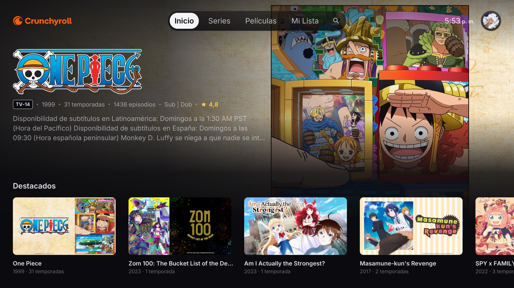
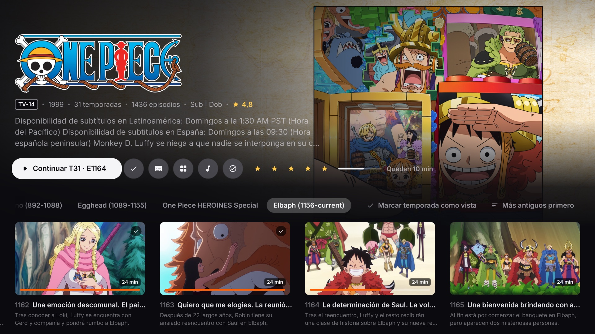
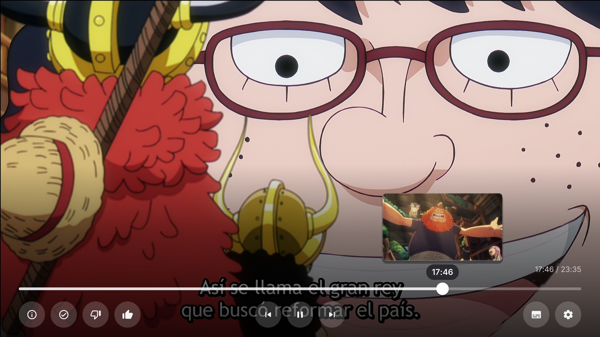

<p align="center"></p>

<h1 align="center">Crunchy for webOS</h1>

<p align="center">
An unofficial, <b>native</b> Crunchyroll client for LG webOS TVs, written in Rust.<br>
No browser engine, no web view, no JavaScript: the UI is drawn with OpenGL ES 2 straight on a Wayland surface,
and video plays through the TV's own Widevine CDM and media pipeline.
</p>

<p align="center">
<a href="https://github.com/powky/crunchyroll-native-rust/releases/latest"><b>⬇ Download the IPK</b></a> ·
<a href="#install">Install</a> · <a href="#performance">Performance</a> · <a href="#building-from-source">Build</a> ·
<a href="#faq">FAQ</a>
</p>



| Series page | Seek thumbnails |
|---|---|
|  |  |

## Why native?

Every other way to watch Crunchyroll on an LG TV — the official app and the community web apps — runs inside
the TV's web engine (on webOS 6, a Chromium 79 build). That engine is a heavy, multi-process browser on a TV that
has four small ARM cores and about 700 MB of free memory. Crunchy replaces all of it with one Rust process.

## Performance

Measured on the same TV (LG OLED55C1AUB, webOS 6.5.3, Mali-G51 MP3), with the same remote script — 20 presses
along the home rows — against the community web app (an [Enact/React client](https://github.com/ediaz23/crunchyroll-webos-stream)
running in LG's web engine):

| | Crunchy (native) | Web app (LG web engine) |
|---|---|---|
| Cold start, launch → window on screen | **0.5 s** | 3.5–3.8 s |
| Profiles on screen after a cold start | **1.0 s** | — |
| CPU while navigating | **0.53 cores** | 1.62 cores |
| RAM after navigating (PSS) | **≈33 MB** | ≈140 MB |
| GPU memory after navigating | **≈102 MB** | ≈296 MB |
| Processes | **1** | 4 (renderer, Node service, a utility process, plus the shared WebAppMgr) |
| Navigation | **60 fps** (16.7 ms a frame) | — |
| CPU at rest | 1.2 % of one core | 1.2 % |
| Playback: OK → first frame | **2.0 s** (2.2–2.8 s without the look-ahead) | — |

<sub>RAM is PSS from `/proc/<pid>/smaps_rollup`; GPU memory from `/proc/gpu/<pid>` (4 KiB pages); CPU from each
process's utime + stime; start times from webOS's own `NL_APP_LAUNCH_BEGIN` → window-visible log events. The web
engine renders at 2× and its GPU memory lives in the shared WebAppMgr process, counted here as what it gained while
the web app was in front.</sub>

Crunchyroll doesn't publish figures for its official LG app. Its LG app needs webOS 4.0 or later
([Crunchyroll help](https://web.archive.org/web/20251114180500/https://help.crunchyroll.com/hc/en-us/articles/23067913715988-Crunchyroll-app-for-LG-TV)),
so it runs on web engines as old as Chromium 53 ([LG's engine table](https://webostv.developer.lge.com/develop/specifications/web-api-and-web-engine)),
and on older sets the web approach shows its cost: a community report on a 2017 webOS 3.5 TV measured 17–45 s to the
home screen and 136 MB for the web app plus 59 MB for its service
([ediaz23/crunchyroll-webos-stream#12](https://github.com/ediaz23/crunchyroll-webos-stream/issues/12)).

## Features

- **Sign in with a code** (crunchyroll.com/activate) and stay signed in; profiles with avatars, create, edit and delete.
- **Home** like the official apps: a hero for the focused title, Continue Watching, the curated rows. Artwork around
  the focus is preloaded (the nearest three already on the GPU), so the hero changes as fast as you move.
- **Series and movie pages:** seasons and episodes (opening at the episode you're on), Continue / Watch, My List,
  star ratings, mark as watched, audio and subtitle languages, Similar and the show's music.
- **Browse:** Simulcast by season, Series and Movies by genre, Music (videos, concerts, artists), My List, Search.
- **Player:** Apple-TV-style controls, **seek thumbnails** while scrubbing (held arrows speed up to 90 s jumps),
  Skip intro / recap / credits, next episode, audio / subtitles / quality menus, thumbs up or down, progress synced
  every 15 s, a spinner on rebuffering, and OK to resume where it was if the TV takes the decoder back (it does when a
  paused video sits under the screensaver).
- **Quick to start:** the episode behind the focused play button (or card) is looked up ahead, so pressing OK goes
  straight to asking for the stream; the episode's still fills the screen while it loads and fades into the video.
- **Always the best stream:** the highest-bitrate 1080p rendition (Crunchyroll's maximum on TVs), shown on the TV's
  4K video plane, which upscales it in hardware.
- **Light on the TV:** a frame is only drawn when something on it changed; at rest the GPU does nothing.
- The interface is in **Spanish** (Latin America); titles, descriptions, audio and subtitles follow your profile's
  languages.

## Requirements

- An **LG webOS TV**. Built and tested on webOS 6.5 (OLED C1, 2021). webOS 5 and 7+ may work but are untested.
- **Developer Mode** or a **rooted TV with Homebrew Channel**, to install an IPK.
- A **Crunchyroll account**; most of the catalog needs a premium plan. Each playback uses one of your plan's
  simultaneous streams and gives it back when the player closes.

## Install

1. Download `com.crunchyroll.webos.native_1.0.1_arm.ipk` from the
   [latest release](https://github.com/powky/crunchyroll-native-rust/releases/latest).
2. Install it with one of:
   - [webOS Dev Manager](https://github.com/webosbrew/dev-manager-desktop) (Developer Mode or rooted): add the TV, then
     drop the IPK on it.
   - The [webOS CLI](https://webostv.developer.lge.com/develop/tools/cli-installation) with Developer Mode:
     ```sh
     ares-setup-device                       # once: add the TV
     ares-install --device <tv> com.crunchyroll.webos.native_1.0.1_arm.ipk
     ```
   - A rooted TV over ssh:
     ```sh
     scp com.crunchyroll.webos.native_1.0.1_arm.ipk root@<tv>:/tmp/crunchy.ipk
     ssh root@<tv> "luna-send -n 1 luna://com.webos.appInstallService/dev/install '{\"id\":\"com.ares.defaultName\",\"ipkUrl\":\"/tmp/crunchy.ipk\",\"subscribe\":true}'"
     ```
3. Open **Crunchy** from the launcher, go to **crunchyroll.com/activate** on a phone or computer and enter the code
   the TV shows.

Developer Mode has to be renewed from time to time in LG's Developer Mode app; on a rooted TV, Homebrew Channel keeps
it alive.

**Remote:** arrows to move, OK to choose, Back to go back. In the player: Up for the seek bar, Left/Right to scrub
(OK jumps there), OK to pause; the remote's play, pause, fast-forward and rewind keys work too.

## Building from source

Needs Rust (stable, with the `armv7-unknown-linux-gnueabi` target), [Zig](https://ziglang.org),
[`cargo-zigbuild`](https://github.com/rust-cross/cargo-zigbuild) and the webOS CLI (`ares-package`). The TV's
libraries (EGL, GLES, the CDM and the media pipeline) are loaded at run time, so no SDK is needed.

```sh
cargo run -p crunchy-tv     # simulator on macOS: arrows, Enter, Esc (no video)
./tools/release.sh          # build/com.crunchyroll.webos.native_<version>_arm.ipk, as released
./tools/install.sh          # install it on a rooted TV and launch it (over ssh)
./tools/push.sh             # dev loop: replace the installed binary and relaunch
```

Icons: releases use Google's Material Icons (`assets/icons/open-icons.json`). A local build uses Apple's SF Symbols
instead when `assets/icons/sf-symbols.json` exists (not in git: Apple's license keeps them out of distributed builds);
`tools/release.sh` always builds without them.

## How it works

- **`crates/core`** — the backend on [crunchyroll-rs](https://github.com/crunchy-labs/crunchyroll-rs): device-code
  sign-in, profiles, the home feed, catalog, playheads, ratings, skip events.
- **`crates/player`** — video without a browser: fMP4 demuxing, the TV's Widevine CDM, and LG's in-process media
  pipeline fed sample by sample, in a window of the app's surface handed to the compositor.
- **`crates/tv`** — the app: a small GPU renderer (one shader, batched quads, text rasterised at the screen's pixel
  size), the Wayland/EGL platform, the screens, and a Tokio worker for the network (HTTP/2, a disk cache, catalog
  pictures fetched as small JPEGs instead of the API's PNGs).
- **`vendor/crunchyroll-rs`** — crunchyroll-rs 0.19.1 with one patch: it keeps the stream's seek-thumbnail link.

## FAQ

**Why isn't the interface 4K?** On LG's UHD TVs every app's interface goes through a 1920×1080 graphics plane; only
video gets the 3840×2160 plane ([LG: app resolution](https://webostv.developer.lge.com/develop/specifications/app-resolution),
and "webOS TV does not support UHD resolution for web apps" in the
[appinfo reference](https://webostv.developer.lge.com/develop/references/appinfo-json)). The web engine renders at 2×,
but the TV scales that back down to 1080p before showing it. Crunchy draws 1080p directly, pixel for pixel; Settings →
Pantalla → Resolución de la interfaz can render at 1440p or 4K like the web engine does, at a GPU cost and with no
gain in sharpness.

**Is the video 4K?** Crunchyroll streams top out at 1080p on TVs. Crunchy always picks the best 1080p rendition and
the TV's video plane upscales it to the panel, as with any other app.

**Does it download or record anything?** No. It plays what your account can play, through the TV's own DRM, like the
official apps.

## Credits

- [crunchy-labs/crunchyroll-rs](https://github.com/crunchy-labs/crunchyroll-rs) — the Crunchyroll API library this app
  is built on (and the platform credentials it publishes).
- [ediaz23/crunchyroll-webos-stream](https://github.com/ediaz23/crunchyroll-webos-stream) — the community web app whose
  screens and behaviour this port follows.
- [GLinnik21/plx-native](https://github.com/GLinnik21/plx-native) — the proof that a native player on webOS is possible,
  and the style of the tab bar.
- [webosbrew](https://www.webosbrew.org) — the webOS Wayland protocol definitions, Homebrew Channel, Dev Manager and
  everything the community has documented.
- [Inter](https://rsms.me/inter/) by Rasmus Andersson and [Material Icons](https://github.com/google/material-design-icons)
  by Google. See [THIRD-PARTY-NOTICES.md](THIRD-PARTY-NOTICES.md).

## Disclaimer

Crunchy is an unofficial project, not affiliated with, endorsed by or sponsored by Crunchyroll or LG Electronics.
"Crunchyroll" and its logo are trademarks of Crunchyroll, LLC; "LG" and "webOS" are trademarks of LG Electronics.
You need your own Crunchyroll account, and use is subject to Crunchyroll's terms.

## License

[MIT](LICENSE) for this project's own code. Third-party components keep their own licenses
([THIRD-PARTY-NOTICES.md](THIRD-PARTY-NOTICES.md)).

<sub>Keywords: Crunchyroll LG TV, Crunchyroll webOS, native webOS app, LG OLED anime, webOS homebrew, Rust webOS,
OpenGL ES, Wayland.</sub>
